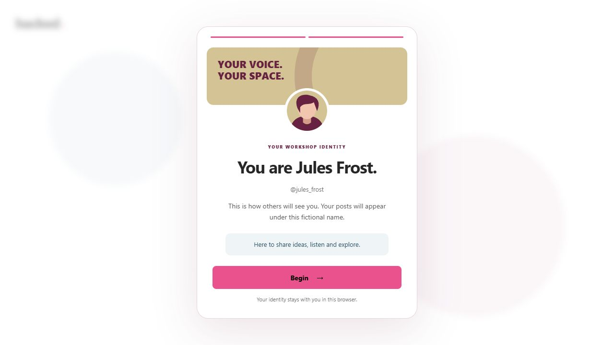
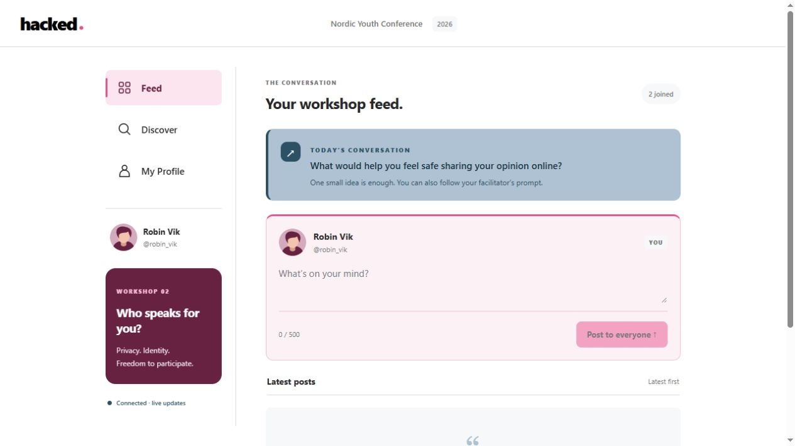

# Open Circle

A small English social app for Workshop 2 at Nordic Youth Conference, exploring privacy, identity and the freedom to participate.

The planned 60-minute Open Circle experience and its Point feature record are
summarized in [the Workshop 2 specification](docs/workshop-2-specification.md).
The Open Circle flow is implemented locally; live hosting and venue verification remain. See [deployment readiness](docs/deployment-readiness.md) for the configuration handoff.
Draft participant copy and cartoon portraits are in
[the seven role cards](docs/workshop-2-role-cards.md).

## Run locally

Requires Node.js 20 or newer. No build step is needed. In PowerShell 7:

```powershell
npm ci --ignore-scripts
$env:HOST_PASSWORD = Read-Host 'Choose a private host password (at least 16 characters)' -MaskInput
npm start
```

Open [the private host screen](http://localhost:4173/host), sign in with that password, and create a **rehearsal** session. Give teams the seven paper profiles and share the participant link or projector QR. To let phones on the same network connect:

```sh
npm run dev:lan
```

Use the network URL printed by the server. A localhost link only works on the computer running the server. `PORT` and `HOST` can override the listening address.

## Current experience

1. Seven teams scan the room QR or open its link. The first modal asks for the name and home town from their paper profile, a public bio based on that person, and a profile picture and banner. Joining matches a unique first name, surname or full paper name (accents optional) to an available role and automatically assigns its anonymous username. No host code is needed. Name and town appear only under the owner’s Private details until the host-controlled identity disclosure. A paper profile can join once; repeated requests from its original browser reconnect safely.
2. The host opens debate. Teams choose public real names or public usernames, give a reason and reply in grouped conversations.
3. The private host confirms **Launch simulated takeover**, **Release forged posts**, and **Release reactions** separately, then begins reflection and confirms **Reveal what happened**. Nothing advances on a timer.
4. Teams can dispute posts shown under their username. At reveal, genuine, injected and scripted contributions are labelled; teams can publish corrections and choose a recovery response.
5. Profile setup is required to enter the forum. Anonymous feed/profile requests are rejected, and setup cannot be skipped with Escape or an old observer preference. An existing team can share a scoped read-only link with another device. The projector shows QR, prompts and aggregate progress only.

Public profiles open from member names and Discover. Replies quote their original post and stay in its conversation. Drafts retain text, stance and reply context across reloads. Unconfirmed sends keep their exact payload until a receipt or retry confirms publication. Saved recovery choices return on reload; the host sees a private aggregate.

The feed updates every two seconds. Browser access tokens are scoped to a session. Local rehearsal uses a persistent PGlite Postgres database in `~/.democratic/open-circle`, outside this repository; `DATA_DIR` can select a different private folder. Hosted mode uses `DATABASE_URL` with PostgreSQL. Session writes, wave releases, claims and retries are transactional. An ordinary restart preserves state.

Read [the rehearsal and operations guide](docs/open-circle-rehearsal.md) before running the workshop. [Implementation status and specification decisions](docs/open-circle-implementation.md) map the work to Point's task order.

## Presenter and QR

Use **Open read-only projector** from the selected session in `/host`. Its URL is `/?s=SESSION_ID&presenter=1`. Participant links carry only the session ID, never host credentials or future script. Open the host using the computer's network address before generating projector links for phones.

`HOST_PASSWORD` is required (at least 16 characters); there is no default password. Host access uses expiring HttpOnly, SameSite cookies, with Secure cookies in production. Server authorization protects previews and every host mutation. Participants receive a public anonymous username; their paper-role name and town are private. No email or participant password is required.

## Design

White outer canvas with CSA palette section colors, varied profile themes and lightweight motion that respects reduced-motion preferences. The visible app does not use the Cybersecurity Academy name or logo.

## Development

```sh
npm test
npx playwright install chromium
npm run test:browser
```

- `server.mjs`: HTTP routes, authorization and safe static-asset serving.
- `storage/`: Postgres adapters, migration and transactional session storage.
- `workshop/`: private role loading, public projections and ordered incident state machine.
- `dist/open-circle.js`: participant setup with Personal info (Bio first) and Profile appearance tabs, plus the read-only projector.
- `workshop/profile-matching.mjs`: reusable `identifyProfileByName(value, profiles)` and `normalizeProfileName(value)`. Handles Nordic letter variants, first/surnames, ambiguity and live typing without returning the private roster to browsers.
- `dist/open-circle.css` and `dist/open-circle-theme.css`: responsive layout, profile choices, keyboard focus and reduced motion.
- `host.html` and `host.js`: server-gated private host interface.
- `host-login.html`: server-gated host login template.
- `tests/`: transaction, privacy, authorization, restart and browser rehearsal tests.

Text-only posts are limited to 500 characters; bios to 160. The server assigns authors, rejects markup and unrelated cross-origin writes, and the client escapes all attendee text. Existing prototype UI files and third-party notices are retained, but obsolete entry points are not served.

## Hosting

No public deployment was made. Static hosting of `dist` alone will not work. Production requires a reachable HTTPS Node service, persistent Postgres, `HOST_PASSWORD`, `DATABASE_URL`, `PUBLIC_ORIGIN`, and `NODE_ENV=production`. The Point plan recommends Render plus Neon; accounts, region, service tier and public URL remain operator decisions. See the operations guide for migrations, backups, retention and deletion.

## Third-party notices

Profile and navigation structure is adapted from [Munia](https://github.com/leandronorcio/munia), revision `577868b63adf2b3d61e25809bd665f8c7687c141`, Copyright 2023 Leandro Norcio, MIT. See `dist/vendor/MUNIA-LICENSE.txt`. This app does not use Munia's full framework/backend stack.

QR generation uses qrcode-generator 1.4.4. Its MIT license header is retained in `dist/vendor/qrcode.js`.

## Earlier prototype previews




