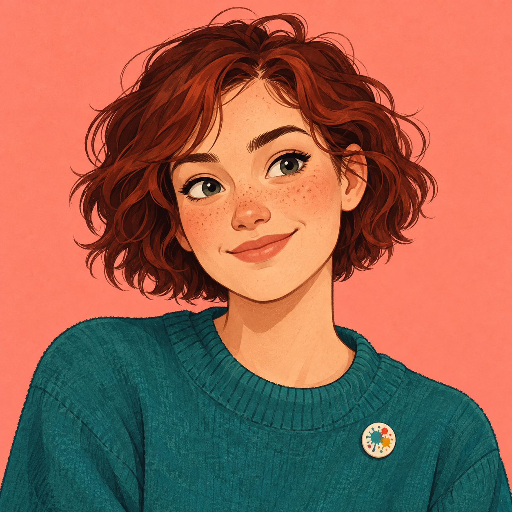
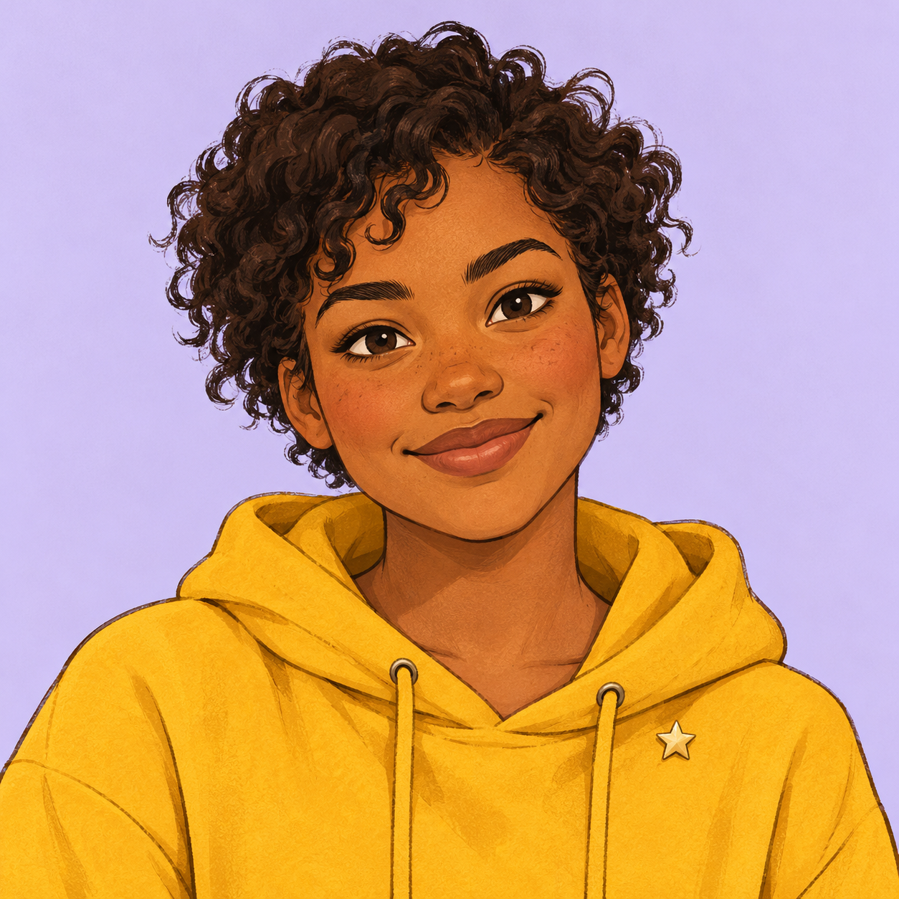
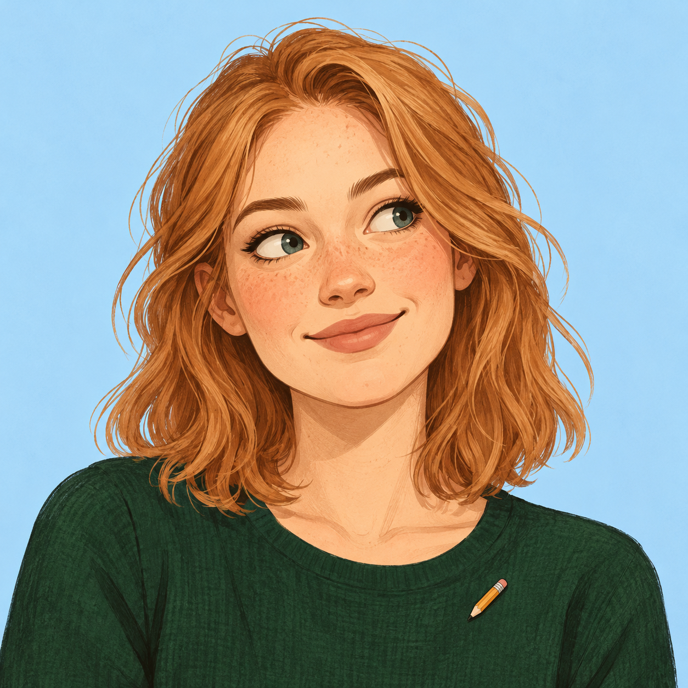
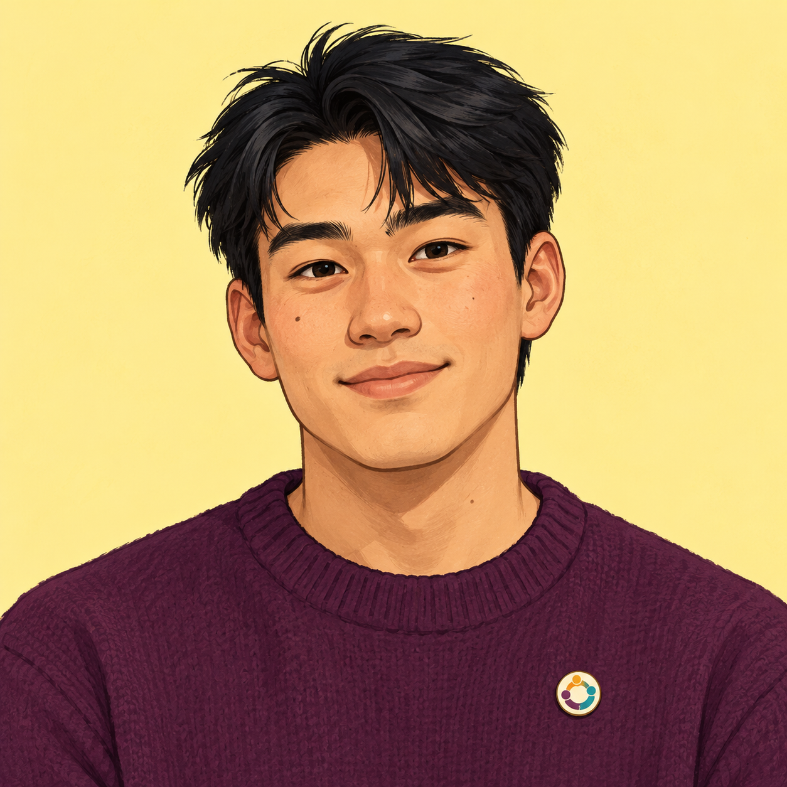
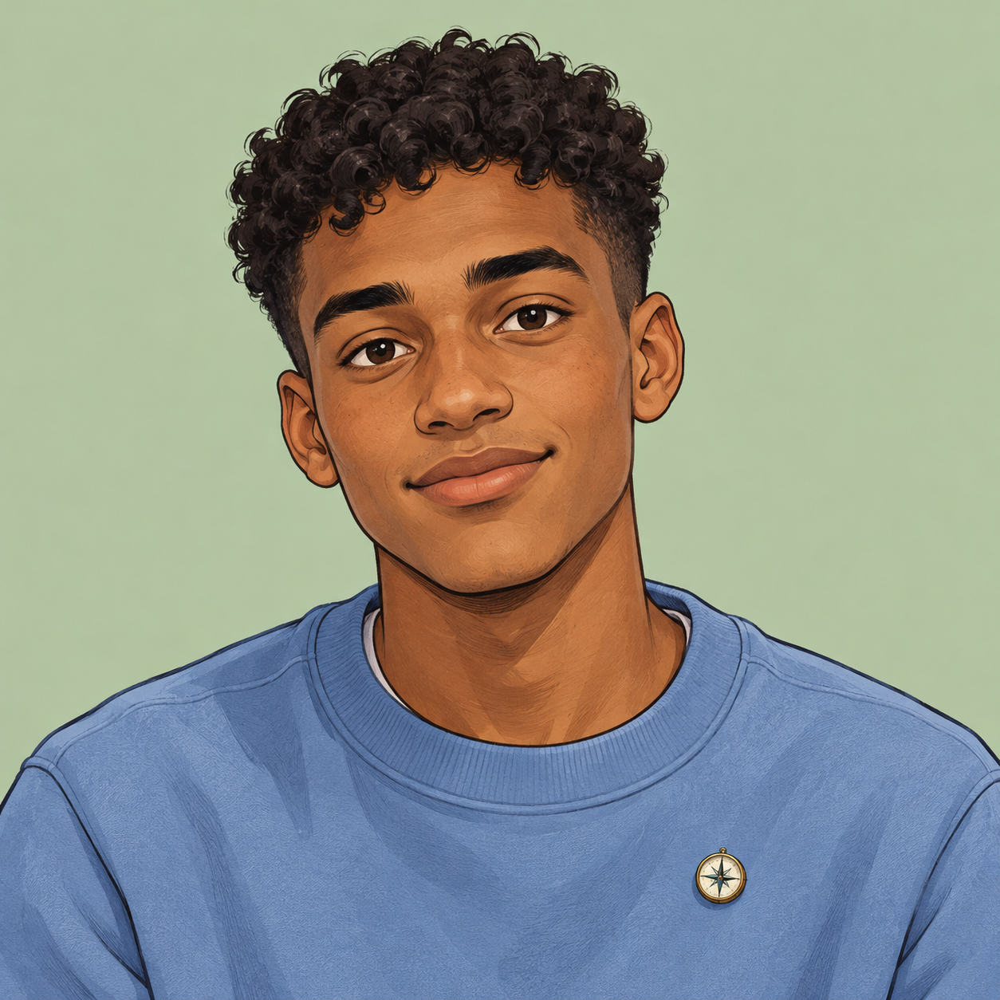

# Open Circle fictional role cards

These seven cards are participant-facing copy for Workshop 2, “Hacked: Who Speaks for You?” Each team receives **one private card**. The portrait can be used on the card and as the account avatar, but the **fictional full name and home town stay off the public forum profile** until the staged incident. The app assigns a neutral public username; the names here are never usernames.

**Character and portrait match:** Eydís, Ingrid, and Linnea are women; Jógvan, Elias, Mikko, and Mats are men. The seven portraits were checked against those character identities.

**Instruction printed on every card:** “You are playing a fictional person. Use their situation to form your opinion. You may write the suggested post in your own words. Post only under the username the app gives you. Do not use your own name, regular username, or personal experiences. Keep this card within your team until the reveal.”

**One question for everyone:** Should Open Circle require members to show their real names on every public post, or allow public usernames?

The suggested posts establish a clear starting position so the later forged reversal is easy to recognize. They are examples, not lines participants must copy. Each role has a genuine concern on both sides of the debate; place of origin does not determine the opinion.

## Card 1 — Eydís Jónsdóttir

**Age, gender and home:** 19 · woman (she/her) · Reykjavík, Iceland  
**Who you are:** You help organize a small youth arts group. Online discussions help you explore ideas before you are ready to defend them in public. You sometimes change your mind after hearing another person's experience.  
**Your starting view:** Open Circle should allow public usernames.  
**Why it matters:** A real-name rule would make every unfinished thought searchable under your name. You want room to ask questions without a temporary opinion following you for years.  
**What you also worry about:** People could misuse usernames to be cruel. You expect the forum to moderate abuse.  
**What might persuade you:** A way to keep your name private from other members while letting moderators verify accounts when serious harm occurs.  
**Public bio you may use:** “I make things with other young people and like hearing new ideas.”  
**Possible first post:** “I would keep public usernames. People need room to test an idea before it is attached to their real name forever. We still need moderators who act when a username is used to hurt someone.”  
**A question to ask others:** “Would you still ask an uncertain question here if every post appeared under your full name?”

## Card 2 — Jógvan Joensen

**Age, gender and home:** 20 · man (he/him) · Tórshavn, Faroe Islands  
**Who you are:** You have helped moderate a community chat. A few people repeatedly returned under new handles after being removed, leaving other members to deal with the same behavior again.  
**Your starting view:** Open Circle should require public real names.  
**Why it matters:** When people stand behind their words, it may be harder to disappear after attacking someone and return as a new account.  
**What you also worry about:** A public name can expose a person who is testing an unpopular idea or speaking from a vulnerable position. You do not want the rule to silence them.  
**What might persuade you:** A username system with strong reporting, private verification, and a clear way to stop repeat abuse.  
**Public bio you may use:** “I care about discussions where people take responsibility for what they say.”  
**Possible first post:** “I lean toward real names on public posts. I have seen how easily someone can return under a new handle after harming others. If we keep usernames, the forum needs a serious plan for repeat abuse.”  
**A question to ask others:** “Who is responsible when a harmful account simply comes back under another name?”

## Card 3 — Ingrid Solheim

**Age, gender and home:** 18 · woman (she/her) · Trondheim, Norway  
**Who you are:** You welcome first-time members to a youth club. Some newcomers speak confidently in person, while others need time before they trust a group enough to share a view.  
**Your starting view:** Open Circle should allow public usernames.  
**Why it matters:** The people most unsure of their place may be the first to leave if a full name is required before they can contribute.  
**What you also worry about:** A welcoming forum also has to protect members from harassment. Privacy should not mean that reports disappear.  
**What might persuade you:** Evidence that a real-name rule brings in more quiet newcomers than it turns away, with an exception for those who need privacy.  
**Public bio you may use:** “I want first-time members to feel able to ask honest questions.”  
**Possible first post:** “I support public usernames. New members should be able to ask a basic question without announcing their full identity to everyone. Moderation can still set boundaries for how we treat each other.”  
**A question to ask others:** “How would a new member know it is safe to speak here?”

## Card 4 — Elias Karlsson

**Age, gender and home:** 19 · man (he/him) · Mariehamn, Åland  
**Who you are:** You coordinate a volunteer group that makes decisions in open meetings. You care about whether a proposal has a real person willing to stand behind it.  
**Your starting view:** Open Circle should require public real names.  
**Why it matters:** If a post asks the community to change its rules, knowing who owns that proposal can make the decision process feel more accountable.  
**What you also worry about:** In a small community, names can make people easy to recognize, and that may keep some good ideas out of the discussion.  
**What might persuade you:** A way to let members use usernames during open debate but attach a verified identity when a formal proposal is submitted.  
**Public bio you may use:** “I like clear decisions and knowing who is speaking for a proposal.”  
**Possible first post:** “For decisions that affect everyone, I lean toward public real names. A proposal carries more weight when someone is willing to own it. I would still make space for people who need privacy to ask questions first.”  
**A question to ask others:** “Should a casual comment and a formal proposal follow the same identity rule?”

## Card 5 — Linnea Sjöberg

**Age, gender and home:** 20 · woman (she/her) · Umeå, Sweden  
**Who you are:** You write for a student publication. Your best work often starts with a question rather than a fixed view, and you have published corrections when you learned something new.  
**Your starting view:** Open Circle should allow public usernames.  
**Why it matters:** A discussion should make it easier to reconsider a position. You worry that a searchable real-name record will reward people for never admitting they changed their minds.  
**What you also worry about:** Members still need to know when a speaker retracts a claim or spreads something harmful.  
**What might persuade you:** A real-name rule that makes corrections and changes of mind normal, rather than treating every old post as a permanent label.  
**Public bio you may use:** “I ask questions, write, and sometimes change my mind.”  
**Possible first post:** “I would keep public usernames. People should be able to rethink an opinion after a good argument, without an old comment becoming the first thing anyone finds about them. The forum should still show corrections clearly.”  
**A question to ask others:** “Does a public name make it easier or harder to say ‘I was wrong’?”

## Card 6 — Mikko Lehtinen

**Age, gender and home:** 21 · man (he/him) · Turku, Finland  
**Who you are:** You facilitate peer discussions. You try to make sure quieter people can finish a thought without being talked over or intimidated.  
**Your starting view:** Open Circle should require public real names.  
**Why it matters:** You suspect that some people would be less willing to target others if their own name appeared beside what they wrote.  
**What you also worry about:** A person who needs privacy may be the one most affected by a public-name rule. Real names alone do not create kind behavior.  
**What might persuade you:** Moderation that reliably protects people while allowing public usernames, plus a private route to verify repeat offenders.  
**Public bio you may use:** “Good conversations need both openness and protection from abuse.”  
**Possible first post:** “I lean toward real names because I want people to pause before targeting someone. But a name is not a moderation policy. If we keep usernames, we need quick reporting and consistent action.”  
**A question to ask others:** “Which rule would make the quietest person in the room feel able to speak?”

## Card 7 — Mats Berg

**Age, gender and home:** 20 · man (he/him) · Tromsø, Norway  
**Who you are:** You have just joined several online youth communities. You are interested in the discussion, but you prefer to learn the tone and rules before sharing personal details.  
**Your starting view:** Open Circle should allow public usernames.  
**Why it matters:** You want to contribute a useful thought before deciding whether to make your identity known to strangers.  
**What you also worry about:** If no one can be held responsible, the community may become hard for new people to trust.  
**What might persuade you:** A public-name option for members who choose it, with effective moderation and private identity checks when needed.  
**Public bio you may use:** “I am new here and interested in how communities make space for everyone.”  
**Possible first post:** “I support public usernames. I would like to join the conversation before giving strangers my full name. The forum should still have clear rules and act when someone abuses that freedom.”  
**A question to ask others:** “Would you try a new community if you had to give every reader your full name on day one?”

## Copy and print notes

Each portrait is a separate square PNG in `assets/role-portraits/`. The text can be shortened for a small printed card, but keep these five elements: private fictional name and home, two-sentence backstory, starting view and reason, one worry about the other side, and the reminder not to use personal details. Keep the public bio and possible first post as optional aids; groups should still feel free to phrase their own opinions.

During the 12–30 minute setup and debate period, hand out cards face down or in envelopes. Ask each team to keep its character's full name and town off the forum until the host-triggered incident. The cartoon portrait may appear as the account avatar because it depicts a fictional person, not an attendee.
